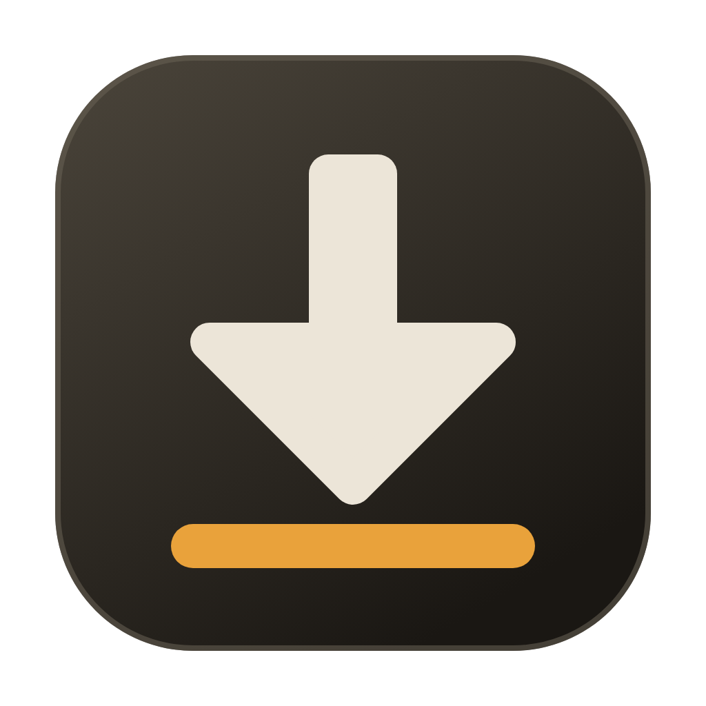
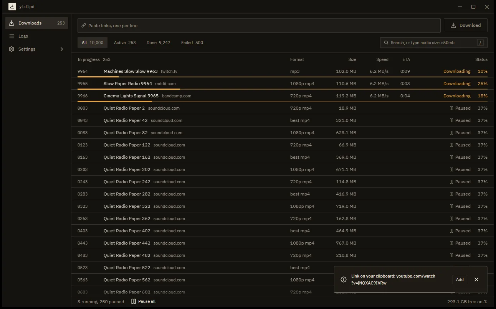
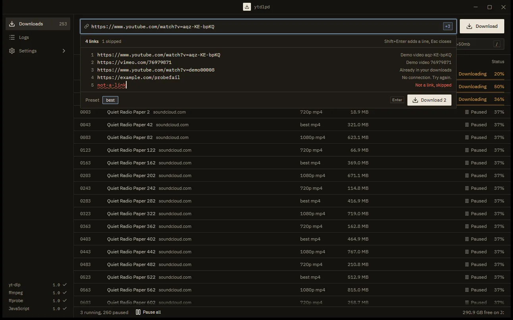
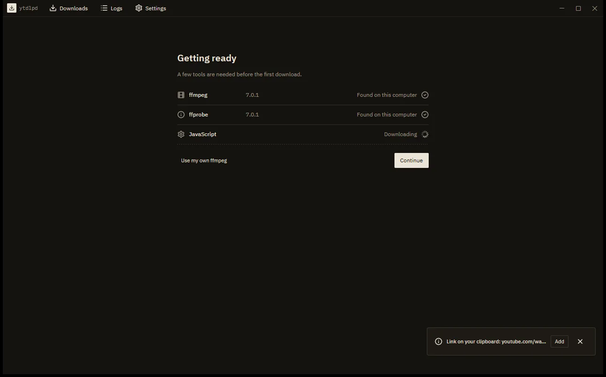
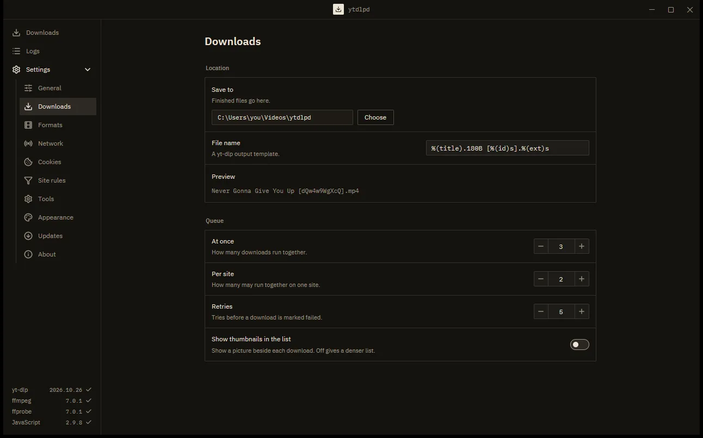
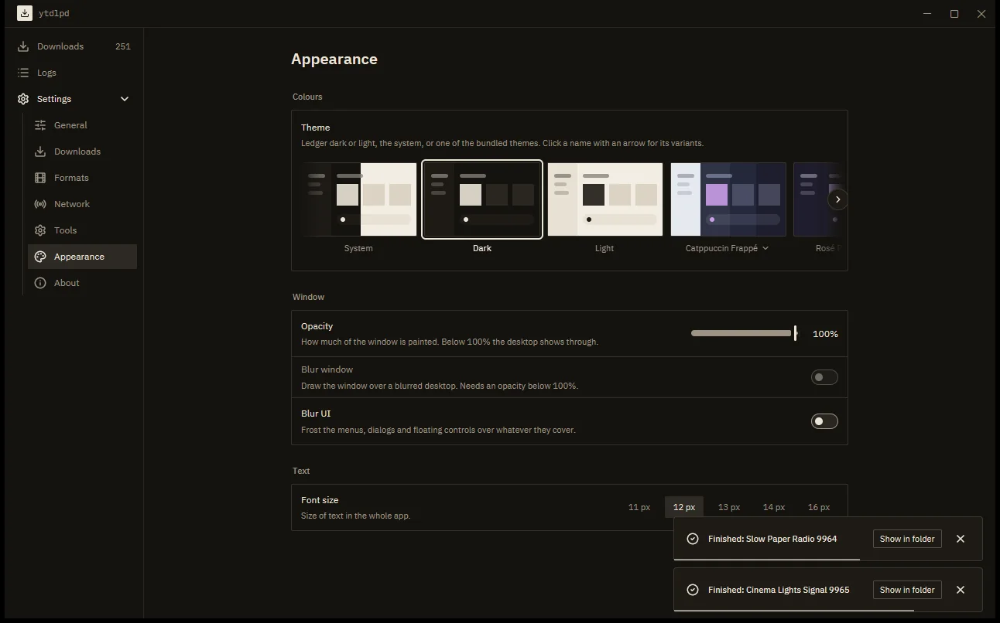

  

<h1 align="center">ytdlpd</h1>

  Paste a link, pick a preset, get a correctly named file. 
  A native desktop app for anything <a href="https://github.com/yt-dlp/yt-dlp">yt-dlp</a> supports, on Windows, macOS and Linux.

  <a href="https://github.com/Venipa/ytdlp-gui/releases/latest"><b>Download</b></a> ·
  <a href="https://ytdlp.venipa.net">Website</a> ·
  <a href="https://ytdlp.venipa.net/docs">Docs</a>

## What it does

- **Paste and go.** Paste one link or many; playlists open as a list you can trim before adding.
- **Presets that convert for real.** Video from best down to 480p, audio as mp3, m4a or opus.
- **A queue you can trust.** Three downloads at a time, two per site. Pause, resume, retry; after a restart unfinished work waits, paused.
- **Files that play everywhere.** After each download the file is checked; if it may not play in QuickTime, Photos or Windows, one click makes it compatible. Repair, loudness and smaller-file fixes are there too.
- **Site rules.** Per site (domain, URL or regex): what the clipboard watch does, which preset to use, which fix to run.
- **Cookies, kept tidy.** Import a cookies.txt, paste one, or copy a browser's; each download only gets the cookies for its own site.
- **Tools fetched for you.** ffmpeg and a JavaScript runtime download when missing; yt-dlp updates without a new app.
- **Native and light.** Rust and GPUI, not a browser in a window. Dark and light themes, plus window blur on macOS and Windows.

## Compared with the old app

ytdlpd replaces the earlier Electron app (the v0.x releases in this repository).

| | ytdlpd | Old Electron app |
|---|---|---|
| Memory, idle | **124 MB** in 1 process | 291 MB in 4 processes |
| CPU, idle | **0.3 %** | 0.9 % |
| On disk: app + tools it downloads | **136 + 205 MB** | 485 + 94 MB |
| Installer size (Windows / macOS / Linux) | **31 / 89 / 61 MB** | 122 / 159 / 174 MB |
| Builds | Windows x64, macOS Apple silicon and Intel, Linux x64 and arm64 (5) | Windows x64, macOS Apple silicon, Linux x64 (3) |
| Runs in | A native window (Rust, GPUI) | Electron (Chromium) |
| Talks to yt-dlp through | Its Python API, with typed progress hooks | Parsing its text output |
| Final file path | Taken from yt-dlp's post hooks | Guessed; a merge or convert that changes the extension shows as an error |
| Queue | 3 at a time, 2 per site (adjustable); pause, resume, cancel and retry in place | Queue waiters leak |
| Progress updates | At most four a second, latest wins | Re-renders on every tick |
| Clipboard | Reads only; site rules decide whether a link is added, offered or ignored | Wipes the clipboard |
| yt-dlp options | The common ones as settings; no free-form arguments | Free-form, split on spaces |
| Site support and speed | Same as yt-dlp | Same as yt-dlp |

ytdlpd v1.0.4 against ytdlp-gui v0.15.3, release builds on an Apple silicon Mac. Memory is the physical footprint (as Activity Monitor shows it) of all the app's processes; CPU is the average over 30 s after start, with nothing downloading. ytdlpd's tools are ffmpeg, ffprobe and a JavaScript runtime (deno); the old app's are ffmpeg. Installer sizes are the release downloads (macOS: Apple silicon, Linux: x64 AppImage).

## Install

Grab the installer for your system from the [latest release](https://github.com/Venipa/ytdlp-gui/releases/latest):

| System | File |
|---|---|
| Windows 10/11 (x64) | `ytdlpd-<version>-windows-x64-setup.exe` |
| macOS 13+ (Apple silicon / Intel) | `ytdlpd-<version>-macos-arm64.dmg` / `-macos-x64.dmg` |
| Linux (x64 / arm64) | `ytdlpd-<version>-linux-x64.AppImage` / `-linux-arm64.AppImage` |

On first start the app fetches ffmpeg and a JavaScript runtime, then it is ready.

## Screenshots

| Many links at once | Getting ready |
|---|---|
|  |  |
| **Downloads settings** | **Appearance** |
|  |  |

## Building from source

See [docs/development.md](docs/development.md) for prerequisites, running a dev build and packaging.

## License

GPL-3.0-or-later. Third-party licenses are in [THIRD-PARTY.md](THIRD-PARTY.md).
