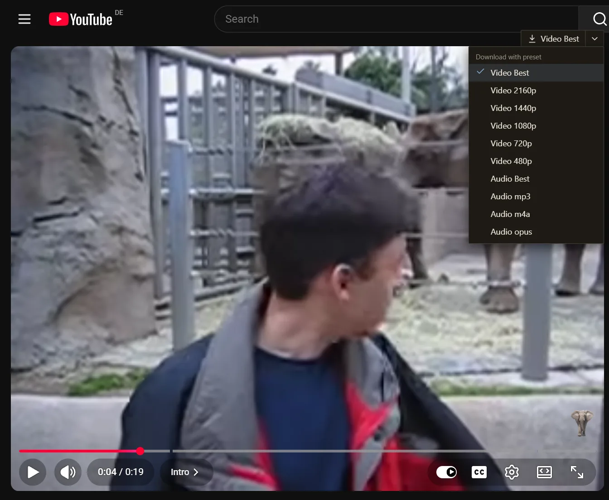
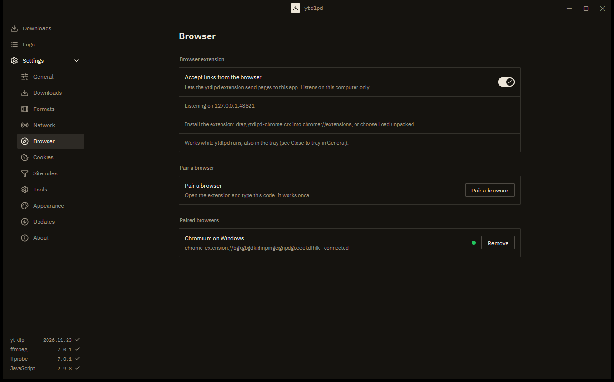
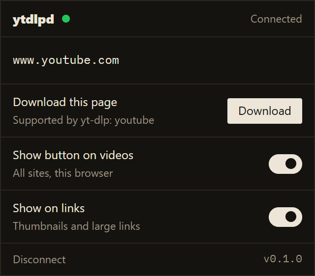

The extension puts a small download button on videos and video links. One click sends the page to ytdlpd, which downloads it like a link you pasted. It talks only to ytdlpd on the same computer, and only after you pair it with a code from the app.

## Install

Each <Repo path="/releases">release</Repo> carries the extension next to the app:

| File | For |
| --- | --- |
| `ytdlpd-chrome.zip` | Chrome, Edge, Brave and other Chromium browsers (version 120 or later) |
| `ytdlpd-chrome.crx` | The same, packed, where your browser accepts it |
| `ytdlpd-firefox.xpi` | Firefox 128 or later |
| `ytdlpd-extension-<version>-source.zip` | The source it was built from |

**Chrome, Edge, Brave**: unzip `ytdlpd-chrome.zip` into a folder you keep, open `chrome://extensions` (`edge://extensions` in Edge), turn on **Developer mode** and choose **Load unpacked** with that folder. Dragging `ytdlpd-chrome.crx` onto the page also works where the browser allows it; most builds refuse a `.crx` from outside their store.

**Firefox**: the `.xpi` is not signed by Mozilla, so release Firefox loads it only until the next restart (`about:debugging`, **This Firefox**, **Load Temporary Add-on**). Firefox Developer Edition and Nightly install it for good once `xpinstall.signatures.required` is off in `about:config`. Then allow the add-on to access all websites in its permissions, or the button cannot appear.

To use it in private windows, allow the extension there in its details page (**Allow in Incognito** in Chrome).

<Callout title="Firefox">
  The Firefox build is new and has had less testing than the Chromium one.
</Callout>

## Turn it on and pair

1. In ytdlpd, open **Settings**, **Browser** and switch on **Accept links from the browser** (off by default).
2. Choose **Pair a browser**. The app shows an 8-digit code, valid for 2 minutes and good for one browser.
3. Click the ytdlpd icon in the browser toolbar, type the code and choose **Connect**.

**Paired browsers** lists each browser with a dot: green while it is connected, red with the time it was last seen. **Remove** signs it out at once; it has to pair again.

The button works while ytdlpd runs, including from the tray (see **Close to tray** in [General](/docs/settings#general)). When the app starts later, the extension finds it again by itself.

## On a page

Move the pointer over a video. If yt-dlp supports the page, the button appears above the player's top-right corner, or inside it when there is no room above. Finding out sends only the page address to ytdlpd, which matches it against yt-dlp's list of sites without downloading anything.

- The main part downloads at once with the preset ytdlpd picks for the site: the format of its [site rule](/docs/settings#site-rules), else the last preset you used.
- The arrow opens the list of presets.
- The button then says **Added**, or **Already in ytdlpd** when the link is in your downloads.

With **Show on links** on, links with a thumbnail or a large clickable area get the button too, after the pointer rests on them for a moment. Small thumbnails get a smaller button with only the icon.

To hide the button, right-click it and choose **Hide on this page** or **Hide on** the site. The browser's own right-click menu has the same choices under **ytdlpd**. The toolbar popup shows when a page is hidden, with **Show again**.

## The toolbar popup

- The connection state, and the site of the current tab.
- **Download this page**: sends the tab to ytdlpd, also for pages without a visible video, when yt-dlp supports them.
- **Show button on videos**: the switch for every site in this browser.
- **Show on links**: the button on thumbnails and large links.
- **Disconnect**: forgets the pairing in this browser. The app lists it until you **Remove** it there.

## Safety

- ytdlpd listens only on `127.0.0.1`, port 47821 (or the next free one up to 47830), and only while **Accept links from the browser** is on. Other computers cannot reach it.
- It accepts connections only from the ytdlpd extension; web pages are refused before they connect.
- A pairing gives the browser its own key. The app keeps only a hash of it; the extension stores it where web pages cannot read it. In Firefox, the extension's own scripts on the page could read it too, which Chrome lets the extension prevent.
- The extension sends page and link addresses to ytdlpd and nothing else, and nothing leaves your computer.

## When it does not connect

| Popup says | What to do |
| --- | --- |
| Not running | Start ytdlpd and check that **Accept links from the browser** is on, then **Try again**. |
| Not paired / Pairing was removed, pair again. | Get a new code in Settings, Browser and enter it. |
| That code has expired, get a new one in ytdlpd. | Codes last 2 minutes; choose **New code**. |
| This extension and ytdlpd do not match, update one of them. | Install the extension from the same release as the app. |

No button on a page usually means yt-dlp has no extractor for it (the popup says so), the page is hidden, or **Show button on videos** is off.
