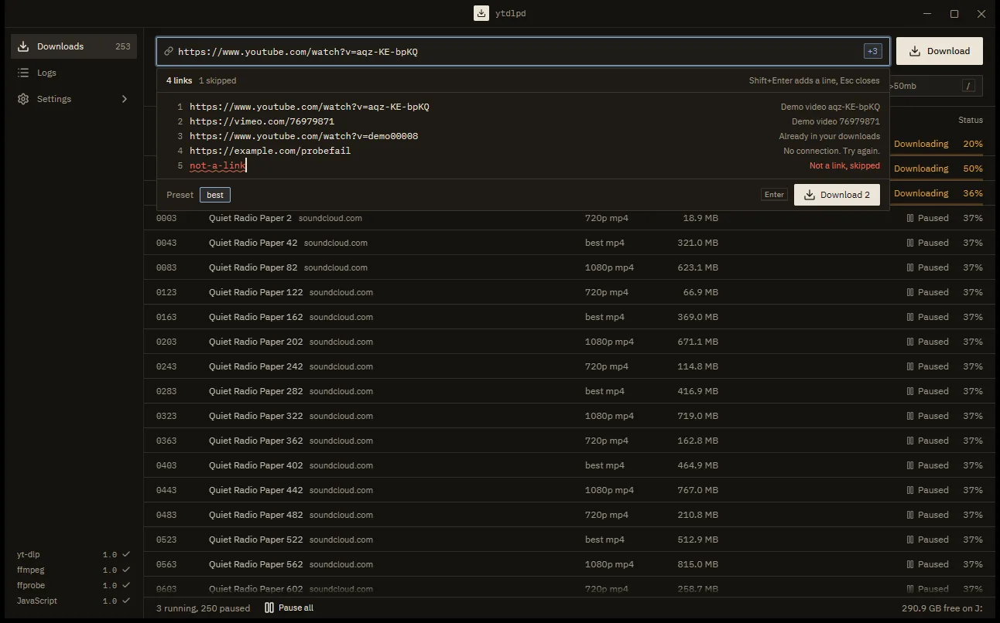

## Paste a link

Paste a link into the field at the top of **Downloads** and press Enter, or press Ctrl+V anywhere on the page. Only `http` and `https` links are taken. You can also drop links, or `.txt` and `.url` files holding links, onto the window.

ytdlpd reads the page first (up to three at a time) and shows a card with the title, uploader, duration and thumbnail. If reading fails, the card says why and offers one action, such as **Open Settings** for "Sign in needed. Add cookies in Settings."

When the link is already in your list, the card says "Already in your downloads".

## Presets

The card offers a preset for video or audio:

| Kind | Presets |
| --- | --- |
| Video | Best, 2160, 1440, 1080, 720, 480 |
| Audio | Best, mp3, m4a, opus (converted with ffmpeg) |

The last preset you used is remembered. **Choose formats** opens a table of every stream the site offers, so you can pick one video and one audio stream yourself. The default preset for the Download button is set in [Settings, Formats](/docs/settings#formats).

## Several links at once

Paste several links (one per line) and the field opens an editor over the list:

- Each line shows its own status at the end: reading, the title, "Already in your downloads", a playlist, or a failure.
- Lines that are not links are marked "Not a link, skipped" and left out.
- One preset at the bottom applies to all links; **Download N** adds them.
- Shift+Enter adds a line, Up and Down move between lines, Esc folds the editor. Folded, the field shows the first link and a `+N` chip for the rest.

## Playlists and channels

A playlist or channel link expands into its entries, read lazily as you scroll. Tick the ones you want (**Select all**, **Select none**); entries already in your downloads are marked. The preset applies to every selected entry and **Download 47** (with your count) adds them.

## The list

Every download is a numbered line. A line that is moving draws an amber rule under it that fills as it downloads; finished, paused and failed lines say their state in words.

- Filter chips: **All**, **Active**, **Done**, **Failed**, each with a count.
- Search narrows the list. Tokens: `type:audio`, `type:video`, `status:failed`, `size:>50mb` (`<`, `<=`, `>`, `>=`, `=`) and `site:youtube.com`. Press `/` to focus the search.
- Hover a line for its actions: pause, resume, cancel, try again, open, show in folder.
- Click a line to open its details in a sheet over the list: thumbnail, link, file path, format, options used, the cookies it used, attempts, error text and the last log lines. Right click opens the actions menu instead.
- If a finished file may not play in QuickTime, Photos or Windows (for example AV1 video with Opus audio), the details say so and offer **Make compatible**. [Site rules](/docs/settings#site-rules) can run a fix after every download from a site.
- Delete an entry (with Undo for a few seconds) or delete the file from disk (asks first).

Downloads run three at a time and two per site by default. Retryable errors such as "Too many requests" back off and try again by themselves. If you close the app while something runs, it comes back paused, ready to resume.

## From outside the app

- `ytdlpd add <url>` from a terminal adds a link to the running app (or starts it).
- `ytdlpd://add?url=<encoded url>` links do the same from a browser.
- With **Watch the clipboard for links** on (Settings, General), a copied link is offered once in a small notice; it is never added without asking unless you turn on **Add copied links automatically** or a [site rule](/docs/settings#site-rules) says so. A rule can also ignore a site's links.
