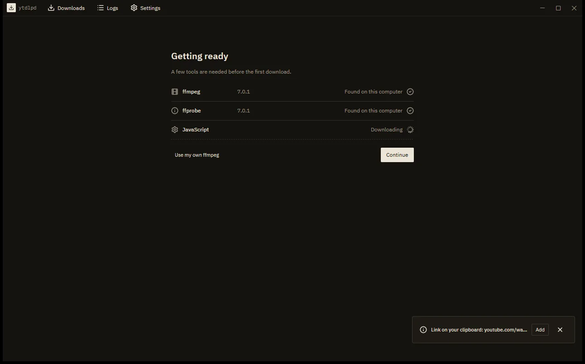

ytdlpd is a native desktop downloader for anything yt-dlp supports: paste a link, pick a preset, get a correctly named file. It runs yt-dlp through its Python API inside the app, so there is no separate yt-dlp to install.

## Install

Get the file for your computer from the [download section](/#download) or the GitHub releases page.

### Windows

Run `ytdlpd-<version>-windows-x64-setup.exe` and follow the installer. Windows 10 and 11 on x64 are supported.

### macOS

Open `ytdlpd-<version>-macos-arm64.dmg` (Apple silicon) or `ytdlpd-<version>-macos-x64.dmg` (Intel) and drag ytdlpd into Applications. macOS 13 or later.

### Linux

Download `ytdlpd-<version>-linux-x64.AppImage` (or `linux-arm64`), make it executable and run it:

```sh
chmod +x ytdlpd-*-linux-x64.AppImage
./ytdlpd-*-linux-x64.AppImage
```

## First run: Getting ready

The first launch shows **Getting ready**, a short list of the tools a download needs and where each one stands.



| Tool | Where it comes from |
| --- | --- |
| yt-dlp | Comes with the app. It can be updated later from Settings, without a new app version. |
| ffmpeg and ffprobe | The path you set, then your `PATH`, else a build for your OS and architecture is downloaded. |
| JavaScript runtime | deno, node, bun or QuickJS if one is installed; else deno is downloaded. YouTube needs it. |

**Continue** turns on once yt-dlp is ready and ffmpeg is ready or you chose your own file with **Use my own ffmpeg**. Later launches skip this screen; if a tool goes missing, Downloads shows a notice with a button to fetch it again.

<Callout title="Offline on first run">
  yt-dlp is part of the app, so you can continue without a connection once you confirm going on without ffmpeg.
  Formats that need merging or converting stay disabled until ffmpeg is there.
</Callout>

## Next

- [Downloading](/docs/downloading): paste links, presets, playlists.
- [Settings](/docs/settings): where files go, cookies, themes.
