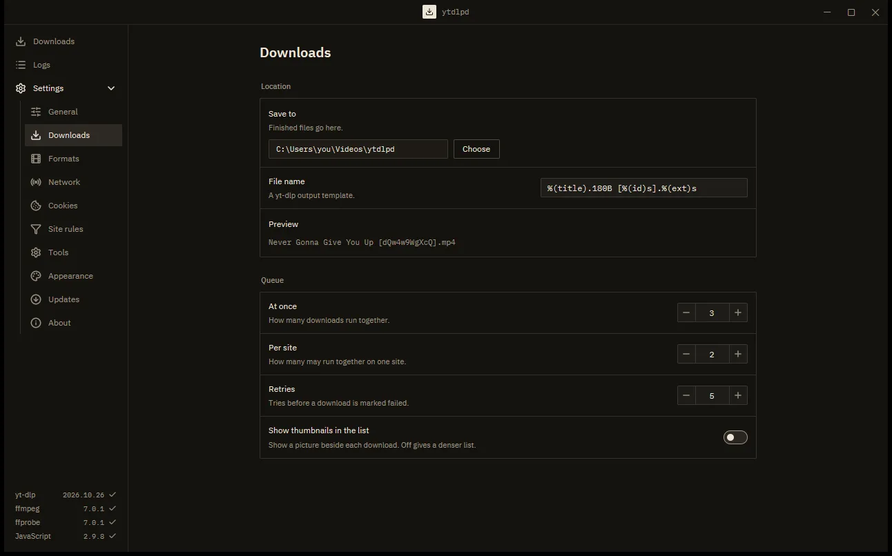
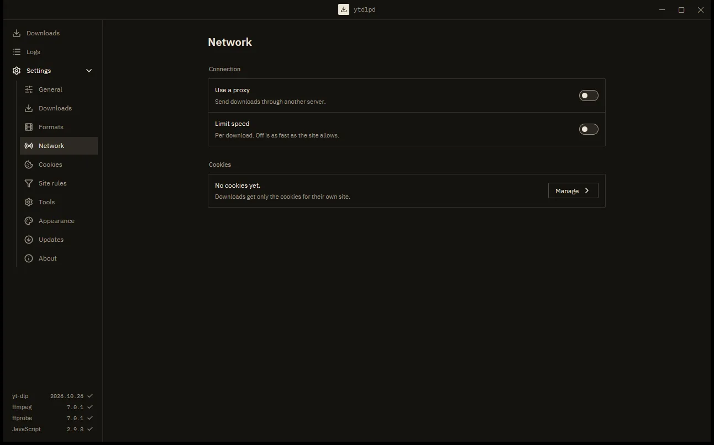
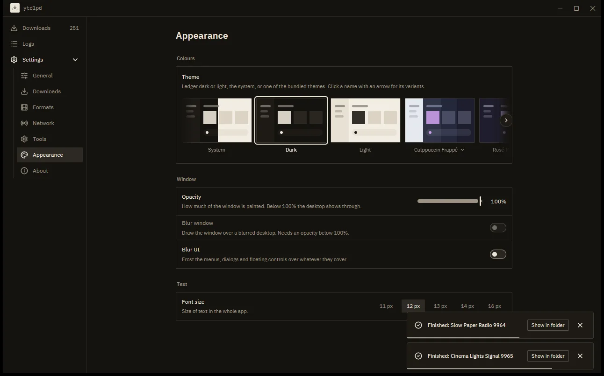

Settings open from the sidebar; each page is listed under it. Changes apply at once. They are stored in `settings.json` (see [where things live](/docs/troubleshooting#where-things-live)), which you may also edit by hand: the app reloads it, and keeps the last good settings if the file is not valid JSON.

## General

- **Language**: the language of menus and messages, or the system language.
- **Start minimised**: open in the tray without showing the window.
- **Close to tray**: closing the window keeps downloads running in the tray.
- **Notifications**: tell you when a download finishes or fails.
- **Watch the clipboard for links**: offer a link you copy as soon as the window is in front. Read only; nothing is cleared.
- **Add copied links automatically**: add a copied link without asking (off by default).
- **Resume interrupted downloads on start**: continue downloads that were running when the app closed.

## Downloads

- **Save to**: the folder finished files go to.
- **File name**: a yt-dlp output template. The default is `%(title).180B [%(id)s].%(ext)s` (the title cut to 180 bytes, then the video id); playlist entries go into a folder named after the playlist. **Preview** shows the name it gives a sample video as you type.
- **At once**: how many downloads run together (default 3).
- **Per site**: how many may run together on one site (default 2).
- **Retries**: tries before a download is marked failed.
- **Show thumbnails in the list**: off gives a denser list.

## Formats

- **Default preset**: what the Download button uses when you do not choose formats.
- **Subtitles**: download subtitles, which languages (`en, de, pt-BR`), and whether to embed them in the video file.
- **Embedding**: embed the thumbnail as cover art, the metadata (title, uploader, date) and chapter marks.
- **SponsorBlock**: for YouTube, **Mark** or **Remove** sponsor segments, and choose which categories (sponsor, intro, outro, self promotion, interaction reminder, preview or recap, off-topic music).

## Network

- **Proxy**: `http://host:port` or `socks5://host:port`. Empty is none.
- **Rate limit**: cap the speed of each download, like `500K` or `2M`. Empty is unlimited.

### Cookies

Some videos need you to be signed in (private, members-only or age-restricted ones). ytdlpd can reuse your browser's sign-in through cookies. Pick one of:

- **None**: no cookies are sent.
- **From browser**: read the cookies of a browser on this computer. **Firefox is recommended.**
- **File**: use a `cookies.txt` file (Netscape format).

**Import cookies file** copies a `cookies.txt` into ytdlpd. **Paste from clipboard** takes the text of one you copied instead, for example from a browser extension that exports cookies. **Clear cookies** removes the stored copy.

<Callout type="warn" title="Chrome and Edge on Windows">
  Chrome blocks other apps from reading its cookies on Windows. Use Firefox, or export a cookies file. If reading
  fails with "Couldn't read the browser's cookies", close the browser and try again, or use a cookies file.
</Callout>

## Tools

ffmpeg, ffprobe, the JavaScript runtime and yt-dlp, each with its version and source. See [Tools](/docs/tools).

## Appearance

- **Theme**: Ledger dark (default) or light, follow the system, or one of the bundled themes (Catppuccin, Rosé Pine, Gruvbox, Solarized, Nord, Dracula). A name with an arrow has variants.
- **Opacity**, **Blur window** and **Blur UI**: make the window see-through and frost what is behind it, where the system supports it.
- **Font size**: size of text in the whole app.

## About

The version, licence (GPL-3.0-or-later), third-party notices, and buttons to open the data folder and the log folder.
