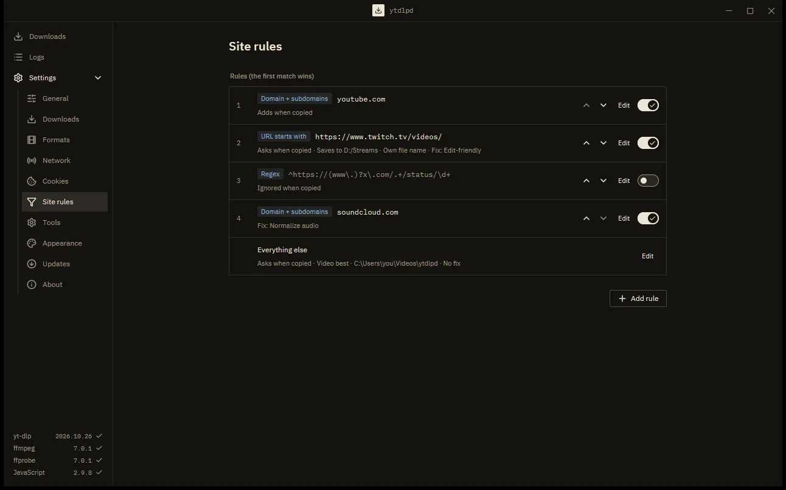
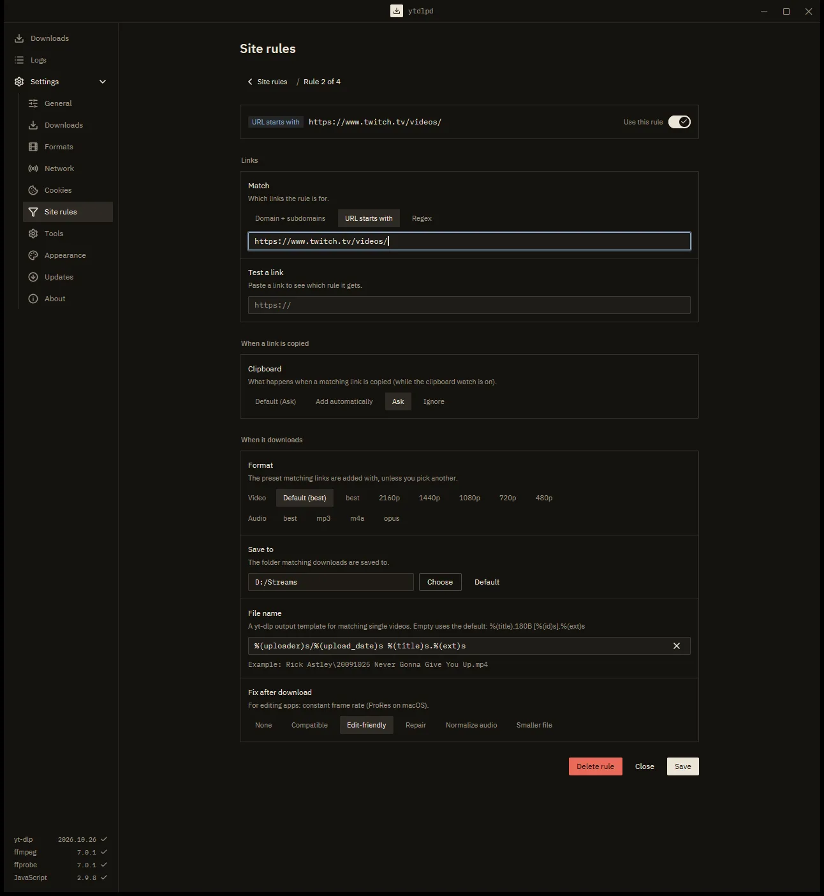

Settings open from the sidebar; each page is listed under it. Changes apply at once. They are stored in `settings.json` (see [where things live](/docs/troubleshooting#where-things-live)), which you may also edit by hand: the app reloads it, and keeps the last good settings if the file is not valid JSON.

## General

- **Language**: the language of menus and messages, or the system language.
- **Start minimised**: open in the tray without showing the window.
- **Close to tray**: closing the window keeps downloads running in the tray.
- **Notifications**: tell you when a download finishes or fails.
- **Watch the clipboard for links**: offer a link you copy as soon as the window is in front. Read only; nothing is cleared.
- **Add copied links automatically**: add a copied link without asking (off by default). [Site rules](#site-rules) can choose per site instead.
- **Resume interrupted downloads on start**: continue downloads that were running when the app closed.

## Downloads

- **Save to**: the folder finished files go to.
- **File name**: a yt-dlp output template. The default is `%(title).180B [%(id)s].%(ext)s` (the title cut to 180 bytes, then the video id); playlist entries go into a folder named after the playlist. **Preview** shows the name it gives a sample video as you type.
- **At once**: how many downloads run together (default 3).
- **Per site**: how many may run together on one site (default 2).
- **Retries**: tries before a download is marked failed.
- **Show thumbnails in the list**: off gives a denser list.

## Formats

- **Default preset**: what the Download button uses when you do not choose formats.
- **Subtitles**: download subtitles, which languages (`en, de, pt-BR`), and whether to embed them in the video file.
- **Embedding**: embed the thumbnail as cover art, the metadata (title, uploader, date) and chapter marks.
- **SponsorBlock**: for YouTube, **Mark** or **Remove** sponsor segments, and choose which categories (sponsor, intro, outro, self promotion, interaction reminder, preview or recap, off-topic music).
- **Converting**: **Encoder** chooses how the [fixes](#fixes) that convert run: **Automatic** uses the graphics chip when ffmpeg has it and the processor otherwise.

## Network

- **Use a proxy**: switch it on and type the address, like `http://host:port` or `socks5://host:port`. A line under the field reads it back (for example "socks5 proxy at 127.0.0.1, port 1080").
- **Limit speed**: switch it on, then set a number and choose KB/s or MB/s. It caps each download; off is as fast as the site allows.
- **Cookies**: how many cookie sets are on and how many sites they cover, with **Manage** to open the Cookies page.

## Cookies

Some videos need you to be signed in (private, members-only or age-restricted ones). ytdlpd reuses a sign-in through cookies, kept as **sets**:

- **Add or read cookies** opens the ways to add a set: **Import file** (a Netscape `cookies.txt`), **Paste from clipboard**, or **Read a browser** (Firefox, Chrome, Edge, Brave; Safari on macOS). A browser set is a copy; **Refresh** reads the browser again.
- **Sets** lists them, highest first. Each can be switched off, moved up or down, edited as `cookies.txt` text (checked as you type) or removed. When two sets have cookies for the same site, the higher one is used.
- **Sites** lists every site the sets have cookies for, grouped (`accounts.google.com` sits under `google.com`), with a search and a switch per site and per set.

Each download, and each link preview, only gets the cookies for its own site (plus `google.com` for YouTube), in a private file that is removed when it ends.

<Callout type="warn" title="Reading a browser">
  Chrome and Edge block other apps from reading their cookies on Windows: use Firefox, or export a cookies file. Safari
  on macOS needs ytdlpd allowed under System Settings, Privacy &amp; Security, Full Disk Access. Chrome on macOS may ask
  for keychain access.
</Callout>

## Site rules

Rules decide, per site, what happens to its links. A rule matches a **domain with its subdomains** (`youtube.com` also covers `music.youtube.com`), a **URL start** (`https://www.twitch.tv/videos/`) or a **regex**, and sets:

- **When a link is copied**: add it automatically, ask, or ignore it.
- **When it downloads**: the **Format** its links are added with (unless you pick another one yourself), the folder it is **Saved to**, its **File name** (a yt-dlp template for single videos, with an example of the result) and a **Fix after download** (one of the fixes below).

Anything a rule leaves on **Default** follows the Downloads and Formats settings. The first switched-on rule that matches wins; **Everything else** holds the defaults. Each rule in the list says only what it changes.

**Edit** opens the rule on its own page, back to the list with **‹ Site rules**. Its **Test a link** field, right under the match, shows which rule a link gets before you save.

### Fixes

| Fix | What it does |
|---|---|
| Compatible | Plays everywhere (QuickTime, Photos, Windows, TVs): picks H.264 and AAC formats first, and converts only when the site has none. |
| Edit-friendly | Constant frame rate for editing apps (ProRes on macOS). |
| Repair | Rebuilds timestamps without re-encoding: wrong length, stutter, seeking. |
| Normalize audio | Even loudness for music and podcasts. |
| Smaller file | Re-encodes to HEVC: about half the size, slower. |

How fixes that convert run (graphics chip or processor) is set under [Formats](#formats), **Converting**.

## Tools

ffmpeg, ffprobe, the JavaScript runtime and yt-dlp, each with its version and source. See [Tools](/docs/tools).

## Appearance

- **Theme**: Ledger dark (default) or light, follow the system, or one of the bundled themes (Catppuccin, Rosé Pine, Gruvbox, Solarized, Nord, Dracula). A name with an arrow has variants.
- **Opacity**, **Blur window** and **Blur UI**: make the window see-through and frost what is behind it, where the system supports it.
- **Font size**: size of text in the whole app.

## About

The version, licence (GPL-3.0-or-later), third-party notices, and buttons to open the data folder and the log folder.
