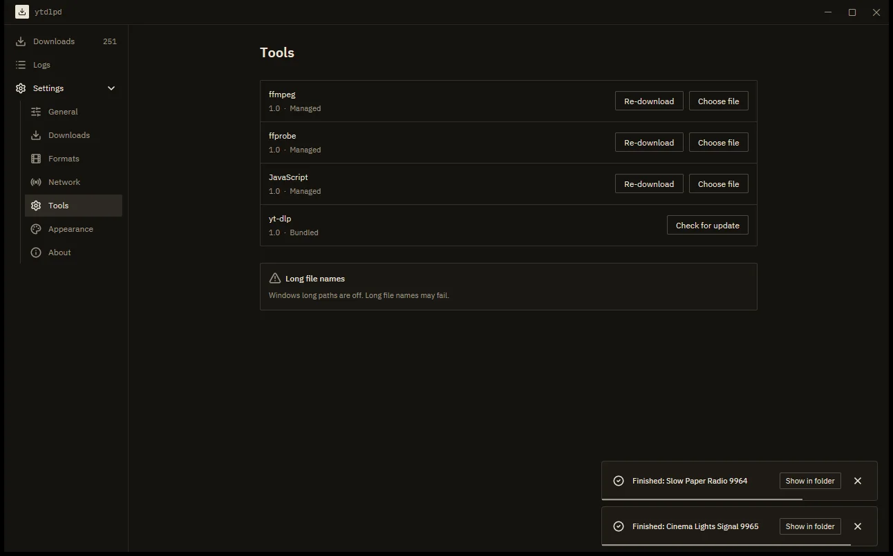

ytdlpd needs four tools. **Settings, Tools** lists each with its version and where it comes from.

| Source | Meaning |
| --- | --- |
| Managed | ytdlpd downloaded it into its data folder and keeps it. |
| Found at a path | An installed copy on your `PATH` is used. |
| Your file | You picked a file with **Choose file**. |
| Bundled | Shipped inside the app (yt-dlp). |

## ffmpeg and ffprobe

Used to merge video and audio streams and to convert audio (mp3, m4a, opus). Looked up in this order: the path in settings, then `PATH`, else downloaded for your OS and architecture (BtbN builds on Windows and Linux, Martin Riedl's builds on macOS). **Re-download** fetches a fresh copy; **Choose file** points to your own.

Without ffmpeg, presets that need merging or converting are disabled, with the reason in their tooltip.

## JavaScript runtime

YouTube needs a JavaScript runtime to solve its challenges. ytdlpd uses deno, node, bun or QuickJS if one is installed, else it downloads deno. A download that fails with "YouTube needs deno" means none was found: download it here, then try again.

## yt-dlp

yt-dlp lives inside the app's Python runtime. **Check for update** asks PyPI for the newest release; **Install** fetches it. New downloads use the new version; running ones finish with the old one. If an update does not install, the old version stays. No app release is needed for a yt-dlp update.

<Callout title="Windows long file names">
  When Windows long paths are off, this page shows "Long file names": files with very long names may fail to save.
  Turning on long paths in Windows (or a shorter file name template) fixes it.
</Callout>
